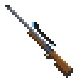

# Doctor Knepper's Long Rifle

A scoped long rifle that fires iron bullets. Left-click to fire from the hip, hold right-click to aim down the scope.



## How it works

- **Fire:** left-click. **Aim:** hold right-click to look through the scope, which zooms in a long way and shows a scope overlay.
- **Damage:** 12 (6 hearts) from the hip, 18 (9 hearts) when scoped. Scoped shots are also faster and perfectly accurate; hip shots spread.
- **Ammo:** Iron Bullets. The rifle uses bullets from your offhand first, then from anywhere in your inventory. With no bullets it just clicks. Creative mode needs no ammo.
- **Cooldown:** 1.25 seconds between shots, with a little recoil kick.
- **Durability:** 465 shots. Repair it with iron ingots.
- Bullets drop slightly over distance, count as projectiles (so Projectile Protection works against them), and disappear after 4 seconds.
- Left-clicking with the rifle never breaks blocks.

## Recipes

**Long Rifle**

| | | |
|:-:|:-:|:-:|
|   | Spyglass |   |
| Iron Ingot | Iron Ingot | Iron Ingot |
| Any Planks | Tripwire Hook |   |

**Iron Bullet** (makes 6, shapeless): Iron Ingot + Gunpowder

## Requirements

- Minecraft **26.3** (Java Edition)
- [Fabric Loader](https://fabricmc.net/use/) 0.20.1 or newer
- [Fabric API](https://modrinth.com/mod/fabric-api)

Install it on both the client and the server.

## Installing

Download `long-rifle-<version>.jar` from the [releases page](https://github.com/DoctorKnepper/Doctor-Kneppers-Long-Rifle/releases), Modrinth or CurseForge, and put it in your `mods` folder along with Fabric API.

## Building from source

You need a Java 25 JDK.

```sh
./gradlew build    # the mod jar ends up in build/libs/
```

## Releasing

Publishing a GitHub release (Releases, then "Draft a new release", with a tag like `v1.0.0`) runs
`.github/workflows/release.yml`. It builds the jar, attaches it to the release and uploads it to Modrinth
and CurseForge. It needs these repository settings (Settings, then "Secrets and variables", then "Actions"):

| Name | Kind | Value |
|---|---|---|
| `MODRINTH_TOKEN` | secret | a Modrinth personal access token with the "Create versions" scope |
| `CURSEFORGE_TOKEN` | secret | a CurseForge API token (from your CurseForge account's API tokens page) |
| `MODRINTH_ID` | variable | the Modrinth project ID |
| `CURSEFORGE_ID` | variable | the CurseForge project ID |

If one platform's values aren't set, the workflow skips that platform. Update `mod_version` in
`gradle.properties` before tagging a new release.

## License

CC0 1.0 (public domain). See [LICENSE](LICENSE).
